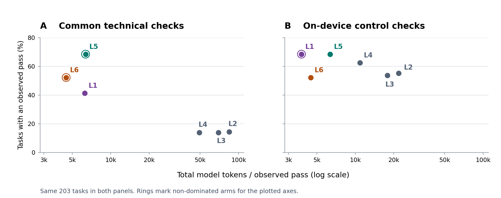

# L1–L6 六档比较：219 题实验结果与进度

论文比较同一批 219 道需求下 L1–L6 六种模型与程序分工。主要衡量每档完整交付卡片的比例，分别报告未经修复的首件和共同修复后的终件，并列出首件产出、技术通过率、耗时与模型调用成本。事先登记的主比较是 L5 对 L4；其余档位按同一分母报告，分环节对照用于解释六档之间的差异。

截至 2026 年 11 月 28 日，六档的生成、计时与取图已经结束。L1 产出首件最多（214/219），L5 在共同技术检查与修复后通过最多（150/219），L6 耗时中位数最低（2.85 秒）。独立必显项标注、视觉判定及适用动作的验证仍有缺口，目前无法判定哪一档的完整交付率最高。

六档技术通过与单位耗时、真机控件核对、组外小卡回放及既有双人评分均已提供去标识汇总。补充数据列出相邻档统计检验、输入样值分层和同机缓存计时。每组结果附来源收据摘要，可在保管区核对原始证据。[实验汇总](../out/tables/six_arm_evidence_20261128.json) · [补充检验](../out/tables/six_arm_robustness_20261128.json)

## 本轮聚焦 L5 与 L6

把固定内容的比较扩至同一批需求中四次独立的内容选择，得到 199 题的 759 个可比回包。四组方向一致。沿用原字号，L5 比补强 L6 多过 93 次。统一标准字号，补强 L6 比 L5 多取得 101 次确认通过，其中 L5 还有 2 次判定未知。两种口径使用相同的模型回包。这里衡量排版的技术通过，未追加人工评分。[四组同内容复算](补强L6与L5的同内容布局对照.md#换一份首次选中的内容布局比较还成立吗)

按尺寸和负载抽 12 题，固定内容后每题排版十次。原 L6 在 12 题上每次选出相同结构，L5 在 3 题上做到。对相同的 120 份模型回复，允许紧凑配方时，L5 通过 101 次、补强 L6 通过 60 次。两侧统一要求标准字号后为 50 比 60。再对这 51 次逐个固定模型给出的布局树，26 次保留标准字号、只减内边距和子项间距就能排下，19 次单改字号能排下而单收留白无效，6 次须两项同时调整。这里比较技术通过，视觉质量另有双人盲评。[同内容重复对照](补强L6与L5的同内容布局对照.md#内容不变重选布局会不会改变结果)

补齐小卡与宽卡候选后，我们对全部 187 份相同内容逐题复算。原字号规则下，L5 通过 150 题，补强 L6 通过 126 题；两侧统一要求标准字号并允许模型保留原树顺序时，分别通过 86、110 题。各口径的单侧通过数、同题耗时与样本范围另列为[补强布局后的同内容对照](补强L6与L5的同内容布局对照.md)。

L5 与 L6 属于预先登记的相邻档次要比较。六档技术结果汇总后，我们追加了固定内容、改良候选和同件复算，用于解释这两档的差距。L5 由模型选内容、给出布局结构，程序计算几何并生成卡片。L6 也由模型选内容，布局结构和后续排版都交给程序。原登记的 L5 对 L4 主比较单独报告。

187 份固定内容对照控制了最后要上卡的文字和动作。复核实际发出的 187 条结构提示，L5 全部可以回看原请求，其中 65 条还有未选的候选字段或动作。原 L6 选型函数只能读取已选内容。因此该对照比较两套实际选型实现，无法单独估计额外上下文对模型成绩的影响。[选型输入的核对方法与结果](补强L6与L5的同内容布局对照.md)

| 问题 | 共同输入 | L5 | L6 |
|---|---|---:|---:|
| 收到原需求后，有多少题首次通过共同技术检查？ | 同一批 219 道请求，两档各自选内容 | 150/219（68.5%） | 115/219（52.5%） |
| 平均每题执行多久？ | 全部 219 题，含早停和未出件，截止执行器结束 | 5.22 秒 | 2.97 秒 |
| 固定内容，仅替换生成布局结构的一步，有多少题通过共同下游？ | 187 份封存的 L5 内容，含相同的文字、主次、对象与操作 | 150/187（80.2%） | 116/187（62.0%） |

在 200 个题组上配对重采样 10,000 次，219 题已观测出件的通过率差为 15.98 个百分点（95% 区间 10.19 至 22.17）。一题 L5 传输状态未知，若按通过处理，差值为 16.44 个百分点。L6 每题平均快 2.25 秒（2.07 至 2.44 秒）。双方都通过的 110 题中，L6 仍平均快 2.45 秒。这里的耗时不含真机渲染。

**当前程序少通过的原因能否用已有规则改善？** 在相同的 187 份内容上追加一次探索性对照。原程序树能通过时保留其原件，超高时按开发期已有的候选顺序尝试，取第一个能以标准字号、原有内容和动作顺序通过共同检查的结构。先封存程序的选择，再与模型选结构的结果对照。第一轮从 116 题提高到 122 题，原先 116 张卡的字节全部一致。新增的 6 张都是宽卡，4 张将内容和末尾操作分栏，2 张将同组信息并排。34 张宽卡中，原程序、候选程序、模型分别通过 13、19、24 张。当时的候选只覆盖宽卡，153 张小卡三种策略分别通过 103、103、126 张。随后补入小卡候选又多过 4 题。10 张新增通过卡都在同一真机出图，8 张带按钮，其中 6 张出现按钮文案省略。候选程序作为补充策略单列，前表中的 L6 耗时来自原冻结实现。[同内容对照与真机观察](补强L6与L5的同内容布局对照.md)

视觉补充针对固定内容后均通过的 115 对。35 对 A2UI 完全相同。从其余 80 对中按冻结种子抽取 12 个不同题组，覆盖 8 张小卡、4 张宽卡。24 个席位中 19 个复用同题同原件真机图，5 个用同台宿主补拍。3 对解码像素完全一致，剩余 9 对进入独立盲评（5 张小卡、4 张宽卡）。全部取图回执为 READY_WITH_WARNINGS；图像相同只计外观相同。每位评审只作 9 次左右判断。该样本用于描述可见差异，不能推算全体请求的视觉合格率。六档大规模人工评审本轮暂缓。

两位评审独立完成全部 9 对。按封存的左右盲码还原后，结果如下。

| 独立评审 | L5 更好 | L6 更好 | 相当且可用 | 两张都有明显问题 | 无法判断 |
|---|---:|---:|---:|---:|---:|
| 评审 1 | 5 | 2 | 1 | 1 | 0 |
| 评审 2 | 1 | 4 | 4 | 0 | 0 |

9 对中，4 对判断完全一致（1 对同选 L5，2 对同选 L6，1 对同选相当且可用）。其余 5 对中，仅 1 对直接选了相反的档位，3 对是评审 1 选 L5、评审 2 判相当，1 对是评审 1 认为两张都有明显问题、评审 2 选 L6。按 18 次判断汇总，L5 与 L6 各获 6 次偏好；这些判断来自同一组 9 对图。这个小样本未显示一致的视觉偏好，也不足以证明两档外观等效。本轮固定内容视觉补充已完成。

上表采用两位评审各自独立提交的原票。揭盲后，协调人转述了一对图的选择澄清。只替换这一对后，18 次判断中 L5 获 5 次偏好、L6 获 7 次，5 次判相当且可用，1 次判两张都有明显问题。一致题数从 4/9 变为 5/9。按原票和澄清后的票分别计算，均不足以判定整体视觉优劣。

### 2×2 小卡的候选覆盖和首次选型

我们追加了一次全自动的机制对照。按题组排除已有人工画面、专项核查与补建样值等曝光后，169 道原正式小卡中余下 39 道，其中 37 道有可还原的首次 L5 内容，分属 33 个题组。规则只用开发资料制定。该子集来自经过筛选的旧报告集，具有二次分析的性质。每题完整保留选定文案、实体、主次、动作与引用顺序。两种选择器得到同一份内容、同序匿名候选和同一组粗略估计。模型与程序各选一次，封存后用相同下游逐个试排全部候选。可行须在原尺寸和标准字号下完整容纳文案与按钮，且同时通过协议、保真及出口检查。

| 参照范围 | 题数 | 模型首选通过 | 程序首选通过 |
|---|---:|---:|---:|
| 全部二次比较题 | 37 | 6 | 5 |
| 至少一种候选可行 | 8 | 6 | 5 |
| 同一菜单内既有可行也有不可行选项 | 4 | 2 | 1 |

每题有 2 至 6 种候选，共 139 种，技术判定均有确定结果。原程序树可行 5 题，加入相邻内容和动作的组合后增至 8 题。其余 29 题中，15 题可在原引擎的紧凑字号档通过，14 题所有候选均未通过几何阶段。8 道有解题中，两边同过 5 题，仅模型通过 1 题，两边都漏选 2 题。只有一个题组贡献了两种首选方法的技术分差，不能据此判定其总体选型能力高低。

模型以同一配置发起 37 次请求，全部取得合法首选，调用型号为 deepseek-flash。程序和模型选择耗时中位数分别为 0.0083 毫秒与 927.8 毫秒，模型包含网络往返。两侧均从已载入的候选开始计时，菜单构建、下游编译和设备渲染均不计入。这组结果衡量冻结首帧值和参考字体下的技术可行性，未据此评分美观或真实交互。

另回顾原 153 道固定内容小卡中仅模型结构通过的 23 题，逐字节复现其模型原件。在原技术标准允许紧凑字号的条件下，新程序菜单在 17 题提供了可行排法，程序一次选中了 11 题，漏选 6 题；另 6 题菜单里没有可行排法。统一要求标准字号后，这 23 题的 97 个程序候选中，54 个未通过几何检查，43 个依靠紧凑字号通过旧门禁，严格通过 0 个。模型原树在同一标准下也仅有 2/23 通过，另外 21 题同样依赖紧凑字号。两组实验有 5 题重合。23 题仅用于归因，数量和成绩均不追加到 37 题的比较中。

事后另测有限候选的程序试排开销。程序首选失败时依公共菜单的原次序继续编译和校验，直到得到一个符合相同技术标准的原件或穷尽候选。三轮独立执行的选择和原件摘要一致，每轮 37 题共尝试 129 个候选。程序保留首选已通过的 5 张原件，补回 3 张，在全部 8 道有解题上都找到了可行方案。公共输入已加载且字体已预热的条件下，每题先取三轮中位数，再跨 37 题取中位数，耗时 13.95 毫秒（第 95 百分位 33.58 毫秒）。该时间含编译、出件和技术校验，与前述仅选出 ID 的时间分别报告。这说明本菜单内的技术可行性可通过程序试排达到，不能据此评定美观程度。

**14 张连紧凑字号也未通过的小卡，能否在标准字号下靠换布局解决？** 固定每张卡的全部文字、动作、字号、10vp 内边距和 4vp 间距，按参考字体的实际字宽计算每段文字换行需要的空间。再允许任意嵌套的矩形行列、自由分配列宽，求保持原阅读顺序时的最低卡高。14 张的下界均超过 150vp，范围为 156～227vp。换一个假设，只固定标题独占一行，允许其余内容任意重排，14 张仍全部超高。若连标题位置与阅读顺序都放开，仍有 10 张超高。第二种独立算法核对了全部 37 张的保序下界，并用原字体引擎逐一校验了 985 个文字框的尺寸。

在这 37 题上再验证两项程序改动。保留能通过的旧原件，对失败卡片先增加按原顺序分栏的候选，在字段与动作归属明确时并排展示。若仍未通过，尝试让相邻的两条带标签辅助信息按实际换行宽度分栏，标题、主值与按钮各用整行。每步都保留全部内容和标准字号，并检查每个文字框、动作绑定、阅读顺序和最终 A2UI。

| 37 题内的分组 | 题数 | 原菜单标准字号通过 | 扩充布局后 | 再按换行宽度分栏后 |
|---|---:|---:|---:|---:|
| 原菜单标准字号已通过 | 8 | 8 | 8 | 8 |
| 原菜单仅紧凑字号可过 | 15 | 0 | 4 | 5 |
| 原菜单全部候选均超限 | 14 | 0 | 0 | 0 |
| 合计 | 37 | 8 | 12 | 13 |

调整列宽让一张临界卡片通过。两条辅助信息均为 14fp，原来两列各宽 63vp，改为 63.75vp 和 62.25vp，两边都能在两行内完整显示。独立回放得到相同结果，原有 8 份 A2UI 逐字节一致。剩余 24 题中，18 题在标题独行并保持原顺序时可证明超高，另 6 题尚未取得符合归属和完整性要求的排法。本次是在查看失败后对同一子集做的自动技术复验，不能用这 5 题的增量估计新请求的收益，也不能据此判定真机外观优劣。[布局搜索实现](../../cardgen-proto/exp/studies/six_arms/small_layout_search.py) · [列宽计算实现](../../cardgen-proto/exp/studies/six_arms/small_layout_column_widths.py)

**余下 6 题能否通过调整同一对象内部的布局改善？** 在同一批 37 题上追加一次容量分析。之前的列宽调整只处理两项带标签的辅助字段。这次允许同一实体的主值和辅助值分栏，也允许一列容纳连续的多个字段。不同实体分区，整卡动作只放在整个正文的侧边或下方。使用参考字体逐项计算换行宽高，沿用原字号、间距、内容顺序和动作绑定。

余下两题分别受动作归属和可读性限制。一题有两个整卡动作，保留独立操作区至少需要 163vp。另一题有一个 147vp 的几何解，但连续五行每行只能容纳一个字。排除这种竖排后，穷举保序行列组合得到的高度下界为 154vp。新增的可读性约束只用于此次试排。

37 题经两个独立进程完整回放，标准字号通过从 13/37（35.1%）增至 17/37（45.9%）。新增的四份来自不同题组，实际整卡占高为 130～140vp。两轮的全部 17 份 A2UI 均逐字节一致，原先 13 份成功产物与旧版本也逐字节一致。未通过的 20 题中，18 题此前已证明超高，另 2 题见上段。本轮只检验参考字体下的固定内容排版，部分标签会换行，未增加模型调用、真机或人工评审。核验还发现输入取值与原请求冲突、快照内部计数与记录不符两种问题，已另行归入输入质量统计。本轮改动是在同一批已分析过的题上复验，正式六档比较仍沿用冻结版本。[同一实体内的布局与列宽搜索](../../cardgen-proto/exp/studies/six_arms/small_layout_scoped.py)

**把相同规则用到调试题组之外，还能多通过多少？** 从原正式小卡中排除 37 题调试批、23 题失败归因批及与其重复的题组等，保留 112 题。15 题的上游内容未通过，1 题没有回包，最终可同内容回放的为 96 题、85 个题组。在这 96 题上按事先锁定的顺序试排，原菜单通过 64 题，加入通用行列结构后通过 65 题，再调辅助字段列宽仍为 65 题，允许同一实体内主辅字段组合后通过 74 题。新增 10 张来自 9 个题组，提升 10.4 个百分点（按题组重采样的描述性 95% 区间 4.2 至 18.2）。三轮判定一致，原有 64 张卡的 A2UI 逐字节相同。程序试排中位耗时由 3.58 毫秒增至 3.70 毫秒，第 95 百分位由 25.70 毫秒增至 211.91 毫秒。

同样 96 题的原模型结构通过 64 题。模型与新程序均通过 63 题，仅程序通过 11 题，仅模型通过 1 题，双方未过 21 题。筛选时排除了一批以“仅模型原结构通过”为条件选出的诊断题，而且原正式题曾在其他分析中曝光；这一组适合核验程序的增量收益，不能外推为程序选型普遍优于模型。纳入全部 153 份可用正式小卡内容后，原菜单通过 73 份，新程序通过 95 份；该敏感性分析包含调试题。所有数字均采用原内容和标准字号，未回填为六档正式成绩。

为什么少数题搜得慢？在原 37 道调试题上做性能采样，一轮共调用 186,725 次字体宽度测量。我们只在一张卡本次搜索内复用同字体对同一段文字的精确测量值。先在 37 题校验，再锁定代码，对 96 题在同机、同预热条件下逐题交错跑五轮。两种实现的 74 份成功原件逐字节相同，所有失败判定一致。以每题五轮中位数汇总，96 题的第 95 百分位从 221.07 毫秒降到 66.25 毫秒（−70.0%），均值从 45.02 降到 16.00 毫秒，中位数从 3.67 变为 3.72 毫秒。该收益集中在需要多次试排的题；此处两端为同一场成对计时，只衡量本地程序排版。[单卡字宽缓存实现](../../cardgen-proto/exp/studies/six_arms/small_layout_measure_cache.py)

## 五步进度

| 步骤 | 已取得的证据 | 剩余工作 |
|---|---|---|
| 1. 固定数据和代码 | 正式集 219 题、200 个题组。其中 169 张小卡、50 张宽卡，比原计划少 31 题 | 按既定 219 题报告 |
| 2. 比较同一内容谁排得好 | 238 个可评真机首帧席位，按图片字节去重为 210 种。甲乙最终总评已齐，104 题双方都有图 | 甲的 4 项澄清已核验。原先按严格量表送第三人判读的 38 席继续单列，本次无新增送审席位 |
| 3. 固定六档输入与评分依据 | 219 份原请求已关联，确认 1,445 个可选事实字段与 154 个可选动作。事实包括原请求所列的 1,221 个字段和按来源补回的 224 个字段。2 道按 7.0 规则补建，另报告剔除后的 217 题 | 独立复核金标与来源（P6），仅看输入标出必显事实、动作及可接受替代项（P7） |
| 4. 六档正式对照 | 每题跑 L1–L6，共 1,314 席。按同一席的相同首终件合并后，真机取图记录 1,159 条，按图片字节去重为 973 种 | 收取六档独立视觉和业务判定，核实适用动作的真实去向 |
| 5. 汇总论文结论 | 可出六档技术主表、固定内容排版表、同候选选择表和同初稿修复表 | 回收上述证据后补完整交付率，按题组计算不确定性 |

第 2 步评的是固定内容实验的两种排版，第 4 步评的是从原始请求开始生成的卡，两套评审分别归档。生成与必显标注并行，实际时间顺序偏离原方案“P7 先于正式生成”的要求。输入标注人员应先交卷，再接触产物，并在论文中披露实际顺序。第二模型扩展集另留 48 题，目前只有这一用途和题单被冻结，尚无另一个冻结型号或该批的执行回执。

11 月 28 日按截图原字节、解码像素与 A2UI 原件复查，旧固定内容卷的 238 席与新六档主比较的图均无完全相同者。六档 L4/L5 内部的每位评审有 337 个终件图位。与同题同臂的首件相比，309 席图与原件均完全相同，28 席发生变化。在收取本轮视觉分数前准备了逐人补评导航。若协调人在开放前锁定同图复用规则，评审先判终件，再独立判 28 张变化首件。相同席位的逐图视觉结果注明引用同一人的终件原判，不能计作两次独立判读；要求对侧截图也相同时，只剩 281 席符合复用条件。

## 表 1　六档生成与代价

| 每档 219 题 | L1 | L2 | L3 | L4 | L5 | L6 |
|---|---:|---:|---:|---:|---:|---:|
| 产出首件 | 214 | 158 | 160 | 187 | 150 | 115 |
| 首件直接通过共同技术检查 | 0 | 0 | 0 | 0 | 150 | 115 |
| 共同技术检查与修复后通过 | 91 | 30 | 29 | 28 | 150 | 115 |
| 每题执行时间中位数（秒） | 4.18 | 15.34 | 11.69 | 8.40 | 5.28 | 2.85 |
| 各档技术通过席位的执行时间中位数（秒） | 3.73 | 13.50 | 10.39 | 7.76 | 5.28 | 2.68 |
| 全部 219 题累计执行秒数 / 终件技术通过数 | 10.76 | 105.83 | 83.94 | 63.38 | 7.62 | 5.66 |
| 真机控件树报告完整文案，且文字与按钮框均在卡内、无相互重叠的终件数 | 147 | 118 | 116 | 136 | 150 | 115 |

**浏览器实际排版时，文字框会超出卡片吗？** 按方案 A2，用 Edge 157 离线重排正式批原件。每阶段 1,314 席中，330 席无原件，另有 4 份 L1 原件无法可靠测量，其中两份组件树无效，一份表达式超出可核实范围，一份绑定值无法按冻结规则转换为显示文字。每阶段实际量到 980 张卡、4,434 个文字框。按成件声明的根矩形逐边测量，单边越界量按 CSS 像素取整后超过 4 px，计该节点一次。首件与终件各有 8 张卡、26 个文字框超过阈值。另计文字在自身框内横向超出可用宽度 4 px 的卡数，这一项可以在整张卡的边界以内发生。

| 浏览器几何检查 | L1 | L2 | L3 | L4 | L5 | L6 |
|---|---:|---:|---:|---:|---:|---:|
| 可测卡数，首件与终件各自计 | 210 | 158 | 160 | 187 | 150 | 115 |
| 单边越界超过 4 px 的卡数，首件与终件各自计 | 0 | 1 | 2 | 5 | 0 | 0 |
| 有框内横向截断信号的首件 | 43 | 95 | 99 | 119 | 0 | 0 |
| 有框内横向截断信号的终件 | 34 | 80 | 87 | 104 | 0 | 0 |

L5、L4 都有可测终件的 144 题中，75 题仅 L4 有横向截断信号，其余 69 题两档都没有。比较文字框越出卡片的像素总量，143 题相同，1 题 L5 更少。L5、L6 都有可测终件的 110 题中，两档均无文字框越界或横向截断信号。这里比较端到端生成的成件，两档可以选中不同内容。按钮标签、自动换行后的纵向字形裁切和真机点击效果均需其他证据。

本次复测沿用原浏览器排版函数与阈值。对于历史函数无法正确显示的直接路径或拼接，先从原件所带数据解出首帧文字，再验证浏览器中的文字与预期一致。重复原件按文件字节和目标尺寸复用。独立用 Chrome 156 测量相同的 1,079 份输入，所有逐件的可测状态、文字框数量、越界和横向截断计数均与 Edge 相符。两种浏览器均采用 Blink 引擎。[匿名结果与配对区间](../out/tables/formal_web_geometry.json) · [原件复测程序](../../cardgen-proto/exp/studies/six_arms/formal_web_geometry.py)

**有哪一档靠低于 12fp 的字出卡？** 按论文 C-05 对每份原件读取组件的显式字号。219 题每档各有一次首件和一次终件检查，每一阶段六档共有 984 件、5,043 个字号声明。没有节点低于 12fp 或 10fp。作为对照，219 张参考卡中有 13 张合计 52 个正文节点为 10fp。六档已出件的首件与终件在下列计数上相同。

| 声明字号和成件数 | L1 | L2 | L3 | L4 | L5 | L6 |
|---|---:|---:|---:|---:|---:|---:|
| 已出件，可读字号声明 | 214 | 158 | 160 | 187 | 150 | 115 |
| 正文和按钮均可确定整卡最低字号 | 212 | 158 | 160 | 187 | 150 | 115 |
| 按历史 C-05，最低声明恰为 12fp 的卡 | 71 | 19 | 23 | 29 | 150 | 115 |

L5 与原版 L6 同时出件的 110 题中，108 题的参考值覆盖率相同，另 2 题覆盖率不同，双方最低字号仍均为 12fp。再按字段核对，在同题、同路径、同首帧值且唯一直接绑定的正文中，可比范围缩至 14 题、27 项。其中 15 项字号相同，12 项在 L6 更小，集中于 4 题。其余内容包括复合文案，无法据此推断字号差。这说明整卡最低值相同也可能掩盖主次文字的差异，而该对照允许两档自行分配信息层级。

1,157 份按字节去重的设备控件树均未记录实际字号。C-05 因此只衡量声明字号，可读性还涉及字形、对比度和裁切。此次算法在读取正式字号得分前固定于提交 `14c40e3`。独立程序核实了 2,628 个检查点的字号计数摘要和参考卡两条阈值的计数。[字号、参考内容覆盖和设备可观测范围](../out/tables/formal_font_size.json) · [离线复算入口](../../cardgen-proto/exp/studies/six_arms/formal_font_size.py)

**同一道请求能省多少时间和 token？** 对每题先算两档之差，再取中位数。时间从请求进入执行器算到结束，含早停、修复和模型网络等待。用量只比较两档全部调用都有服务端计量的题。括号内是按题组重采样 10,000 次的 95% 区间。

| 正式分工的同题比较 | 执行时间节省，219 题 | 输入 token 节省 | 输出 token 节省 | 用量可比题数 |
|---|---:|---:|---:|---:|
| L5 相对 L4，预定主比较 | 3.05 秒（2.89–3.21） | 2,331（2,280–2,388） | 326（278–355） | 215 |
| L6 相对 L5，相邻档比较 | 2.42 秒（2.28–2.53） | 2,154.5（2,082–2,230） | 64.5（56–66） | 218 |

按方案 §4.4 补报双侧 Wilcoxon 配对符号秩。零差剔除，并列取平均秩。另在每个题组内先取中位数，再让各题组等权检验，六项差异方向均保留。两种检验的原始概率、配对数、零差数及剔除两道补建题后的结果见机读表。检验未经多重比较校正，速度和用量只回答资源问题。[配对差与区间](../out/tables/paired_resource_differences.json) · [配对计算程序](../../cardgen-proto/exp/studies/six_arms/paired_resource_differences.py)

**具体快在哪一步？** 从 1,314 席原始执行记录中取出各阶段的起止计时，同题两档都到达该阶段时才比较。下表的中位数先逐题相减再计算。

| 分工变化 | 两侧均进入该阶段 | 该阶段中位节省 | 全部 219 题从进入到退出执行器的中位节省 |
|---|---:|---:|---:|
| L4 → L5，尺寸和位置交给程序 | 183 题 | 3.188 秒 | 3.054 秒 |
| L5 → L6，布局结构也交给程序 | 182 题 | 2.409 秒 | 2.418 秒 |

183 题中有 144 题两侧都完成几何阶段，只看这 144 题，L5 仍比 L4 中位快 3.069 秒。两侧进入结构阶段的 182 题均完成了该阶段。模型阶段时间已包含网络等待，出口只有校验与修复的合计时间。整席时间还包括前序失败的题，两档进入同一阶段时所选内容也可能不同。固定内容和固定布局树的效果另见分环节对照。[逐阶段 P50、P95、最大值与请求数](../out/tables/formal_stage_timing.json) · [回执复算程序](../../cardgen-proto/exp/studies/six_arms/formal_stage_timing.py)

正式批登记了 3,181 次请求，其中 3,165 次有完整服务端计量。输入共 7,268,046 token，含缓存命中 5,635,813 和未命中 1,632,233。输出共 949,428 token。其余 16 次用量未知。三项可按给定单价估算已计量部分的费用，实验期实际账单缺失。[六档缓存与用量明细](../out/tables/six_arm_cache_token_cost.json) · [回执核对与费率试算](../../cardgen-proto/exp/studies/six_arms/cache_token_cost.py)

**复现参考卡中的值，各档要花多少 token？** 复用 219 道正式题的原件，按论文方案的备选口径计算每张达标卡的用量。一张卡须通过原协议校验，首帧正文包含至少 80% 的参考值，且浏览器实测每个正文框超出卡片任一边不超过 4 CSS px。该代理指标用于分析参考值覆盖与成本。六档正式预注册中的必显覆盖、原生字形与完整业务交付另行判定。[方案与阈值](论文实验方案.md#43-逐项定义)

| 终件，参考值覆盖阈值 80% | L1 | L2 | L3 | L4 | L5 | L6 |
|---|---:|---:|---:|---:|---:|---:|
| 达标数，全部 219 道同题 | 127–132 | 108–109 | 111–112 | 126–127 | 100–101 | 78 |
| 达标数，六档均有完整用量回执的 203 题 | 120–125 | 101–102 | 105–106 | 117–118 | 92–93 | 73 |
| 每张达标卡的总用量，203 题，约 token/张 | 4,213–4,389 | 23,985–24,223 | 18,342–18,516 | 11,687–11,787 | 9,497–9,601 | 6,502 |

用量含失败、修复和早停的全部已计量调用。表内范围给出未知结果可取的上下界。对 219 题逐题配对，L4 和 L5 均达标 94 题，仅 L4 达标 32 题，仅 L5 达标 6 题，另有 1 题两档待定。阈值改为 60% 或 100%，L4 的已知达标数仍高于 L5，L5 仍高于 L6。直接比较 L5/L6，在两档均完整计量的 218 题中，L5 每张约 9,392–9,486 token，L6 约 6,531 token。

**差距主要发生在出卡之前。** 仅 L4 达标的 32 题中，31 题的 L5 在生成阶段已被拒，余下 1 题的 L5 成件参考值覆盖不足。只看两边都出件且可测的 143 题，L4 达标 95 题，L5 达标 97 题。只看 L5、L6 均出件且可测的 110 题，二者达标数为 75 和 74。全体 219 题中仅 L5 达标的 26 题，有 25 题的 L6 未出件。浏览器还在 L4 的 126 张确定达标卡中检出 80 张正文在自身框内横向溢出；L5 的 100 张和 L6 的 78 张均未检出。框内截断是另测的视觉风险。上述子集均按实际出件结果选取。

**这把尺能量到什么？** 219 份登记参考卡中，218 份有可比值，共 701 项，545 项在正式生成输入的相同字段上取值相同。用参考卡自己的正文反测，203 张可测，189 张达到 80%，14 张低于阈值；其余 16 张有 1 张参考集合为空，15 张含无法完整解出的文字表达式。历史文字匹配器在首帧 `Text` 上查归一化后的字面值，独立文字拼接也可能命中，按钮文案、事实归属和真机字形可见性均在其测量范围之外。限定为参考值全部能在输入相同字段找到的 156 题，L4 达标 122 题，L5 达标 98 题，L6 达标 75 题。该子集的数据条件与全体题不同。

保管方在正式生成结束后运行评分。首次读出参考得分前，计分实现已登记在提交 `bab23d5`。另一套提取与计分实现独立复核了 2,628 个首件、终件记录的计数摘要，以及合格数、配对表和成本界限。首终件来自同一批分配席位。逐题值、原图与答案索引继续隔离。[匿名主表及敏感性分析](../out/tables/formal_reference_cost.json) · [覆盖与截断分项](../out/tables/formal_reference_cost_diagnostics.json) · [复算入口](../../cardgen-proto/exp/studies/six_arms/formal_reference_cost.py)

**卡上显示的数字能找到出处吗？** A5 用历史匹配器从首帧正文抽取日期、时间、百分比及其他数值，同一张卡的相同片段只计一次。匹配器在该题的参考值或模型实际收到的请求文字中双向查找。下表先在每张可测卡内计算有出处的比例，再按卡等权平均。每档仍列全体 219 道题。首件与终件的下列计数相同。

| 六档正式题 | L1 | L2 | L3 | L4 | L5 | L6 |
|---|---:|---:|---:|---:|---:|---:|
| 正文有数值且可测的卡 | 184 | 138 | 139 | 164 | 126 | 92 |
| 有卡，正文没有可计数值 | 26 | 20 | 21 | 23 | 24 | 23 |
| 无卡 / 正文无法解析 | 5 / 4 | 61 / 0 | 59 / 0 | 32 / 0 | 69 / 0 | 104 / 0 |
| 有出处片段 / 全部可测片段 | 330 / 438 | 238 / 315 | 233 / 310 | 302 / 412 | 211 / 271 | 138 / 169 |
| 每卡平均数值支持率 | 80.92% | 81.49% | 81.87% | 79.91% | 81.71% | 83.42% |
| 同时覆盖至少 80% 参考值，且正文有数值、数值全部有出处的卡 | 91 | 77 | 82 | 86 | 71 | 65 |

同题配对后，L5 相对 L4 的平均差为 **+1.26 个百分点**，121 题中 L5 高 7 题、L4 高 2 题、112 题相同，按题组重采样的 95% 区间为 −0.15 至 +3.19 个百分点。L6 相对 L5 为 **+0.19 个百分点**，87 题中各高 1 题、85 题相同，区间为 −0.26 至 +0.88 个百分点。两组区间均包含零；这些估计只适用于两档均出卡且有数值可测的题。六档合计可测的 843 个席位中，每席修复前后的数值片段数和支持率都相同。此观察不能判断修复是否改善版式。

参考卡自身也有未命中。219 张参考卡中有 201 张可测，3 张正文没有数值，15 张正文无法完整解析；逐卡平均支持率为 95.35%。在六档终件中，1,915 个卡内去重片段有 463 个未获历史规则支持，其中 231 个能在正式输入的已登记样值中找到边界、数值和单位写法均吻合的片段。另 232 个在这两种检查下均未获支持。字面检查无法判定数字是否挂在正确对象上，也无法还原当时设备上的实际值。正文按钮文案不在此项统计内。

实际请求中有 1 题同时带有两份不同的请求文案，改取备用原文时，该题六档两个检查点的支持数均未改变。方法在读取本轮 A5 得分前固定于提交 `ae9aabe`。保管方用独立的正文提取与汇总程序调用历史匹配器，2,628 个检查点的状态、支持数和分母与主程序逐席一致。按相同原件重算的 A4a 计数摘要也与已发表结果一致。[六档数值出处、同题差值与敏感性分析](../out/tables/formal_numeric_fidelity.json) · [离线复算入口](../../cardgen-proto/exp/studies/six_arms/formal_numeric_fidelity.py)

**技术通过与资源的取舍。** 对预定的 L5 与 L4 比较，L5 比 L4 多通过 55.71 个百分点（200 个题组配对重采样，95% 区间 47.26 至 63.93）。综合技术通过数和累计执行时间，只有 L5、L6 满足“没有其他档既通过更多又耗时更少”。L5 比 L6 净多通过 35 题，整批多花 492.45 秒，相当于每净增一份通过多花 14.07 秒（10.15 至 22.02）。执行时间含失败、早停与网络等待。在两档模型用量均有完整回执的 218 题中，平均每获得一份技术通过，L5 消耗 6,324 token，L6 消耗 4,468 token。

**换用真机控件证据后，差距有多大？** 981 个有图终件中，782 个可逐项匹配原件全部文字和按钮文案，所有文字和按钮框都在卡内且彼此不重叠；184 个可观测到框越界或相互重叠，15 个该项证据不足。全部六档均以 219 题为分母，缺件和缺证据分别登记，均不算取得有证通过。L5 与 L1 的共同技术检查相差 59 题，真机这项检查只差 3 题（150 比 147；两档同过 110 题，差 1.37 个百分点，题组配对 95% 区间 −7.04 至 9.76）。L5 与 L6 在这项检查相差 35 题（差 15.98 个百分点，10.13 至 22.27）。控件报告完整文案时，字形仍可能在框内被截断；这些数也不检验内容是否符合请求或按钮是否打开正确页面。

**技术通过数以 L5 最高。** 将 16 次传输缺测和 2 次参考几何不可判保留为未知，各档可能通过数依次为 91–97、30–33、29–34、28–31、150–151、115。即使每个未知结果都朝有利于其他档的方向取值，本批题的技术首位仍是 L5。剔除两道补建输入后，L5 为 148–149，L6 为 113。上述范围仅反映这批题上的缺测。执行时间包含早停；通过席位的中位数取各档自己的通过子集。两种计时均截止于执行器结束，未含真机渲染。[六档技术配对复算](../../cardgen-proto/exp/studies/six_arms/technical_yield.py)

**L6 比 L5 少通过的题落在哪里？** 两档均能确定技术结果的 218 题中，110 题都通过，40 题仅 L5 通过，4 题仅 L6 通过，64 题都未通过。另 1 题 L6 通过、L5 传输缺测。因此按全部 219 题统计取得的通过，净差为 40 减 5，共 35 题。单看 L6，104 个拒绝中有 32 个停在模型内容阶段，72 个在程序几何阶段被拒。两个档位分别进行首次内容选择，归因到结构要结合同上游原件的回放。

对“每道分配题是否实际取得终件技术通过”补做相邻档双侧配对检验，所有 219 题均入分母。传输或判定缺测记为未取得有证通过，其真实状态在上面的范围内另报。按题组整体交换两档标签，在标签可交换的零假设下计算精确概率。预定的 L4→L5 比较单列，仅前档有证通过 0 题，仅后档 122 题。其余四个相邻比较一起做 Holm 校正：L1→L2 净少 61 题（校正后 p < 0.000001），L2→L3 和 L3→L4 各净少 1 题（均为 p = 1），L5→L6 净少 35 题（校正后 p < 0.000001）。逐题精确 McNemar 检验方向一致。这些检验只涉及实际取得的技术通过，完整交付的预定检验仍缺评分。[配对检验与多重比较复算](../../cardgen-proto/exp/studies/six_arms/adjacent_yield.py)

读者可直接核验上述五个相邻档检验。在 `cardgen-proto/exp/studies` 目录运行以下命令。公开材料按每次比较分别提供同题单侧通过数，以及 200 个题组中各个净差出现的次数。程序从这些分布重算双侧概率与校正值，并与已发表的结果逐项比对。

```sh
python -B -m six_arms.adjacent_yield --public ../../../paper/out/tables/six_arm_robustness_20261128.json
```

按冻结输入尺寸分层，169 道 2×2 题上，L5 通过 126 题（74.6%），L6 通过 104 题（61.5%）。50 道 2×4 题上，L5 通过 24 题（48.0%），L6 通过 11 题（22.0%）。两种尺寸的本批技术通过数均以 L5 最高。宽卡只有 50 题，这些比例仅描述本批。

L4 与 L5 的预定主比较改变几何排版的分工。按全体 219 题配对，L5 平均快 2.885 秒，按题组重采样的 95% 区间为 2.614 至 3.142 秒；剔除两道补建题后平均快 2.878 秒。两侧各自实际生成的上游内容可能不同。为分辨各阶段的作用，我们另用封存的上游原件逐题复算。

| 单独置换的阶段 | 两侧共同入口 | 模型结果 | 程序结果 |
|---|---:|---|---|
| 结构生成，固定内容，各自输出一棵树 | 187 题 | 两侧均产生结构，模型生成的结构有 150 题走通下游 | 当前程序生成的结构有 116 题走通。双方通过 115，仅模型 35，仅程序 1，均未过 36；程序生成结构后的 71 个拒绝均出现在随后的几何环节 |
| 几何排版，固定内容与结构 | 190 题 | 28 题通过，160 题未过，2 题传输缺测 | 155 题通过，35 题未过。在双方都有判定的题中，仅程序通过 125 题，仅模型通过 0 题 |
| 主题应用，固定内容、结构与几何 | 187 题 | 完成主题阶段 160 题，26 题遭阶段检查拒绝，1 题缺回包 | 187 题均完成主题阶段。186 道双方可判的题中，最终均通过 29 题、仅程序通过 2 题、均未过 155 题；缺回包的一题程序也未过 |
| 输出 A2UI，固定到着色完成的树 | 159 题 | 产生 158 份首件。独立保真检查 156 份匹配、1 份文字有差异、1 份顺序无法判定 | 产生 159 份首件。158 份匹配、1 份顺序无法判定。两侧最终均有 30 题通过全部技术检查 |

这些是针对本次实现的机制对照。每行各从相应模型档的封存上游开始，因此共同入口题数不同。结构、主题与协议三行属于看过正式运行后的补充分析。结构一行在 170 个题组中，程序减模型的通过率差为 −18.2 个百分点，按题组重采样的 95% 区间为 −24.6 至 −12.2。主题一行测的是主题能否按协议完成。双方都完成着色的 160 题中，最后通过的是完全相同的 29 题。主题美观程度需单独评。

**结构差距发生在哪一步？** 正式程序按相邻实体分组，一次生成一棵树。窄卡的组依次纵向堆叠，宽卡在相邻两组均有实体时才把两组并排。它在生成结构时没有枚举多种树并按测量结果挑选。复查 187 题，双方使用的文字和动作引用及其数量逐题完全相同。仅模型通过的 35 题中，程序树全部在几何阶段报整卡超高，27 棵程序树完全没有横排，模型树则全部含横排。即使只看双方叶节点顺序也一致的题，这 35 题中仍有 32 题。反方向也有 1 题，模型用了更多横排仍超高，程序通过。证据指向当前实现如何组合已有内容，替代结构的可行性与多种可行结构间的视觉优劣应分别测量。[结构生成规则](../../cardgen-proto/exp/studies/six_arms/harness_v2/program_stages.py)

另用开发题检验程序是否漏选过可行结构。10 题中有 9 题取得同一份内容和可复算的模型结构。用相同的几何程序校验，模型原选结构通过 7 题，程序原选结构通过 5 题。逐一试过程序已有的候选后，7 题至少有一种可行排法。“本月日程”的原树即使用紧凑字号也需要 151vp，卡高为 150vp。仅调整结构就有四种候选能用标准字号通过。这项开发集复算说明了程序漏选的机制。候选中至少有一棵能通过只代表可行性上限，仍需另测自动选择和视觉质量。

复算时，在 `cardgen-proto/exp/studies` 目录先运行 `python -B -m six_arms.formal_stage_replay FORMAL_BATCH FIDELITY_DIR NEW_OUT`，再运行 `python -B -m six_arms.stage_pair_counts FORMAL_BATCH/analysis/roster.jsonl NEW_OUT`。首个命令核对上游输入、请求与产物摘要，回放结构、主题及协议三个环节，并调用独立协议保真检查。它需要保管方冻结的队列适配器、同版运行器与原始回包。第二个命令仅从这三个环节的去标识记录和题组名单复算终局配对。几何行来自另外封存的同树几何回执。正式盲题和逐题评分保存在保管区。[阶段回放工具](../../cardgen-proto/exp/studies/six_arms/formal_stage_replay.py) · [配对统计工具](../../cardgen-proto/exp/studies/six_arms/stage_pair_counts.py)

### 每取得一份通过，要消耗多少 token？

六档共发起 3,181 次模型请求，其中 3,165 次有完整 token 回执，16 次缺失，分属 16 道题。下图取六档用量均完整的同一批 203 题。每档成本包含这 203 题的全部调用，含提前停止和最终未通过的运行。纵轴是实际取得相应通过的题数除以 203。两道 L1 参考几何不可判的题保留在分母。入选取决于回执是否齐全，因此两图均为描述性比较。



图 A 采用共同技术检查。L5 的通过数最高（139/203），每份技术通过消耗 6,354 token。L6 通过 106 题，每份消耗 4,478 token。若只比较 L5 和 L6，可用 218 道两档回执均完整的题。L5、L6 分别有 150、114 道取得技术通过，累计使用 948,575、509,384 token。用整批增量除以净增的 36 份通过，得到 12,200 token 和 13.31 秒/份。这一比值描述切换整批档位的代价。

图 B 检查真机上能否匹配原件的文字和按钮，以及这些控件的边框是否都在卡内、互不重叠。L1 和 L5 都通过 139/203。其中共同通过 105 题，各有 34 题仅自己通过。L1 每份真机控件通过消耗 3,789 token，L5 为 6,354 token。若预算按每道分配题计算，L6 用量最低（2,338 token/题），L1 为 2,594，L5 为 4,351。每份通过和每题预算回答不同问题，两种分母都列入机读表。

原冻结业务指标的可用成本结论是下界。假设某档最终至少有一份完整交付，将全部 219 题已记录 token 除以该档最多可能交付的份数，L5 每份至少约 6,282 token，L6 至少约 4,447 token。独立评审仍可能判定更少的交付，16 次缺回执的调用也可能有成本。这些下界不能确定业务成本排名。[六档成本与双指标汇总](../out/tables/six_arm_cost_frontier.json) · [保管区复算程序](../../cardgen-proto/exp/studies/six_arms/cost_frontier.py) · [从公开汇总重绘图形](../../cardgen-proto/exp/studies/six_arms/plot_cost_frontier.py)

### 哪些技术失败能在真机上观察到？

按每次运行第一次阻断交付的技术检查归类。同一席只进一格。每档均有 219 席，原件、终件回执与分配记录按题目、档位和摘要匹配。[逐原因计数与 L5/L6 同题交叉表](../out/tables/six_arm_failure_modes_20261128.json) · [离线复算程序](../../cardgen-proto/exp/studies/six_arms/failure_modes.py)

| 终局 | L1 | L2 | L3 | L4 | L5 | L6 | 合计 |
|---|---:|---:|---:|---:|---:|---:|---:|
| 技术通过 | 91 | 30 | 29 | 28 | 150 | 115 | 443 |
| 内容校验拒绝 | 0 | 27 | 27 | 28 | 31 | 32 | 145 |
| 出件前几何阶段拒绝 | 0 | 1 | 1 | 1 | 37 | 72 | 112 |
| 主题输出解析失败 | 0 | 29 | 26 | 0 | 0 | 0 | 55 |
| 直接生成或最终输出解析失败 | 1 | 1 | 0 | 0 | 0 | 0 | 2 |
| 原件的树结构或动作校验拒绝 | 3 | 0 | 0 | 0 | 0 | 0 | 3 |
| 出件后参考几何未通过 | 118 | 128 | 131 | 159 | 0 | 0 | 536 |
| 缺回包或参考几何不可判 | 6 | 3 | 5 | 3 | 1 | 0 | 18 |

145 次内容拒绝涉及 39 道原题。登记首错中，71 次是动态文字与绑定路径的首帧值不符，41 次是实体名或标签中出现校验器找不到出处的数字，包括展示编号。其余为静态事实无法逐字核对 10 次、JSON 语法错误 10 次、单位为空 8 次、绑定值为非标量 5 次。校验器遇到首错即停，这些计数无法估计用户必显内容的遗漏率。55 次主题拒绝均由 JSON 解码器报告首个值后还有额外内容。

L5 独过的 40 题中，36 题的 L6 已经选出内容，但生成的树超过卡高，另 4 题在内容阶段停止。L6 独过的 4 道双方可判题中，L5 有 3 题在几何阶段停止，1 题在内容阶段停止。另 1 道 L6 通过题的 L5 缺回包。两档合计 109 次容量拒绝中，105 次是该棵树需要的高度超过卡高，4 次是 L5 的组件超出行数上限。判断其他结构能否容纳相同内容，见前述同内容对照。

536 个出件后参考几何未通过的终件全部留有原图。209 件仅触发文字测量规则，327 件还触发父子容器规则。按相同原件对齐真机文字和按钮控件树后，结果如下。原生检查能核对控件文案、边界和相交情况，字形在框内是否被裁掉仍需另证。

| 有真机图的终件 | 控件证据完整且未见越界或相叠 | 已见越界或相叠 | 其余证据不足 | 合计 |
|---|---:|---:|---:|---:|
| 参考几何未通过 | 339 | 184 | 13 | 536 |
| 参考几何不可判 | 0 | 0 | 2 | 2 |
| 技术通过 | 443 | 0 | 0 | 443 |
| 合计 | 782 | 184 | 15 | 981 |

三个原件说明了不同的失效位置。第一例中，两档均生成了登记正确的操作，但目标按钮位于卡片下方，两张截图上都看不到入口。第二例的原生控件框实测交叠 41 像素，截图能看到末行正文叠在按钮底色上，按钮文案下缘被截。第三例将登记的跳转地址写错一个分隔符，原件被动作检查拒绝，未产生截图。三个案例的原件索引、原生截图及摘要封存在保管区。此表覆盖 853 次已确定的技术拒绝；完整业务交付仍按独立必显项和交互证据判定。

## 表 2　固定待排版内容

| 219 题同内容、禁止自行删项 | 模型排版 | 程序排版 |
|---|---:|---:|
| 通过共同输入转换 | 137 | 137 |
| 生成首件并有真机图 | 130 | 108 |
| 首件通过参考几何检查 | 72 | 108 |
| 同时出图的 104 题，只有本侧获甲最终总评合格 | 6 | 9 |
| 同时出图的 104 题，只有本侧获乙最终总评合格 | 8 | 11 |

238 张图都有两份最终总评，其中 203 张一致（85.3%），35 张有分歧。同题两种方法都出图的 104 题中，甲判 61 题都合格、28 题都不合格，乙判 71 题都合格、14 题都不合格。两位评审各自判为仅程序合格的题数均比仅模型合格多 3 题。这项描述只覆盖实际取得双图的题，只有 9 对宽卡，待排事实和动作合计至少 6 项的宽卡没有配对画面。共同输入转换另拒绝了 82 题。现有证据支持程序的参考几何优势，整体视觉偏好仍无定论。

**只改变选结构的方法，能排下多少题？** 事后复用 11 月 25 日实验的 137 份已转换输入。模型收到内容、主次、实体关系、动作归属、用户偏好和参考宽度，程序选型所用的业务信息也全部来自这份输入。沿用两边当时提交的结构树，两侧共用冻结的几何计算、字号、协议输出与检查程序。两边都可使用行、列和同一批内容节点，选树时没有规定相同的有限候选菜单。复算方法先提交，再读取这项新比较的结果。

| 同题比较 | 模型选结构 | 程序选结构 |
|---|---:|---:|
| 137 题中，成功出件且通过参考几何检查 | 88 | 108 |
| 仅看双方结构均合法的 132 题，成功出件且通过参考几何检查 | 88 | 105 |
| 137 题中，另经原检查程序证实内容和动作合同也通过 | 62 | 69 |

在双方结构均合法且严格检查能明确区分胜负的 5 题中，均为 2×2 卡片，其中 4 题含按钮。逐树核对发现，5 份模型结构都将内容纵向排列，交给同一几何程序后均因容量不足而被拒。5 份程序结构都将至少两项文字并排，保留同一批内容节点后均通过几何、内容与动作检查。

在双方都提交合法结构的 132 题中，88 题都能排下，17 题仅程序选的结构能排下，27 题两边均未排下。137 题中可核实的内容、动作及几何全部通过数相差 7 题，即 5.11 个百分点（按题组重采样的 95% 区间为 1.60 至 9.35）。40 题至少一侧证据未决，若让未知结果取所有可能值，差值范围为 −15.33 至 +32.85 个百分点。程序侧 108 件逐字节复现原件。换用共同几何程序后，模型侧 88 件中仅 19 件与本题既有原件字节相同，另 69 件没有来自本次复算的真机图或人评。该结果支持这套程序规则在这个几何引擎上更常选到放得下的结构。视觉质量沿用上表的独立实验口径。[匿名配对结果](../out/tables/formal_content_only_structure_bridge.json) · [冻结复算方法](../../cardgen-proto/exp/studies/fixed_layout/formal_content_only_structure_bridge.py)

**几何检查能否替代两位评审的总评？** 把 238 个有图席位的既有总评逐一与生成时的参考几何判定匹配，保留同图在不同请求中的评价。结果如下。

| 参考几何 | 有图席位 | 两人最终均判合格 | 两人最终均判不合格 | 两人最终意见不同 |
|---|---:|---:|---:|---:|
| 通过 | 180 | 122 | 26 | 32 |
| 未通过 | 58 | 14 | 41 | 3 |

共 40 席得到两位评审一致且与几何方向相反的总评，其中 26 席几何通过、14 席几何未过。使用首轮独立原判时，仍有 30 席出现这一现象；另有 65 席意见不同、1 席总评不齐。同题双方都有图的 104 题中，有 32 题仅程序几何通过；两人最终均判仅程序合格的有 8 题，均判两侧同合格或同不合格的有 16 题，其余 8 题未形成一致的配对判定。该对照复用了已有评分，不新增人工工作。它衡量参考几何与实际评分的对应关系，不能将比例套用到未评过的六档产物。[计数与配对复算](../../cardgen-proto/exp/studies/fixed_layout/geometry_review_calibration.py)

**几何检查能预测评审更喜欢哪张吗？** 在上述 104 道双图题中，两种排版有 72 题均通过参考几何，另 32 题只有程序通过。偏好栏只对该评审按分项判定两张均合格的题开放。甲有 61 题可填，实际填写 58 题。将程序相对模型的几何通过差值与甲在同一题的明确偏好配对，按并列取平均秩，Spearman ρ 为 **0.392**。

| 甲填过偏好的题 | 选程序 | 选模型 | 明确平手 |
|---|---:|---:|---:|
| 只有程序通过参考几何（10 题） | 9 | 1 | 0 |
| 双方均通过参考几何（48 题） | 18 | 29 | 1 |

甲可填但留空的 3 题均为几何双过。乙有 2 题可填，均留空。这个相关系数只描述甲实际选择的 58 对。即使双方几何都过，甲仍对其中 47 对表达了明确方向。

还按同一批原件检查了字号。104 对中，46 对的两张卡最低声明字号同为 12 fp，另 58 对同为 14 fp。任一侧低于 12 fp 或 10 fp 的文字及按钮标签节点数都为零。设备控件树没有报告实绘字号。另一次 L5/L6 固定内容盲评的 9 对在入选时就要求两侧技术通过，每张最低声明字号也均为 12 fp。两位评审分别给出 8 和 9 个可排序选择，另有 1 票为“两张都有明显问题”。两项实验中每对卡的字号差均为零，因此无法估计字号与偏好的相关程度；9 对专项中的几何通过差值也恒为零。这里分别使用各实验的独立原票，属于事后校准。[匿名列联与可估范围](../out/tables/layout_preference_calibration.json) · [相关系数复算](../../cardgen-proto/exp/studies/fixed_layout/preference_calibration.py)

## 表 3　固定候选内容

**模型第一次选内容时，同一题会得到几种选择？** 正式 L2–L6 对每道题发出的内容提示逐字节相同，温度均为 0。1,095 次调用中取得 1,092 份独立回包，其中 947 份通过内容合同、145 份被拒，另有 3 次传输缺测。193 道题各有至少两份合法回复，可在题内组成 1,841 对。按动态路径或静态原文比较，1,592 对选了相同的事实。限定输入含动作候选时，983/993 对选了相同的动作。限定所选事实相同后，1,265/1,592 对的标签、文字和单位也完全相同。这里衡量选择能否复现，业务上该选哪一项仍由独立输入证据判定。

把每份合法回复送入同一个冻结 L6 排版程序，上述 193 题中有 111 题每次通过、67 题每次未过，**15 题仅改变上游内容回复就出现过成功和失败两种结果**。有 69 对合法回复在技术通过上分歧，其中 52 对选择的事实或动作不同。其余 17 对选项相同，差异还可能来自文案、主次、归属等字段，现有比较未逐项干预。相同的回复出现在不同配对中，每一对均不能当作独立新题。[内容分项与题内配对统计](../out/tables/matched_content_repeats.json) · [相同下游复算](../../cardgen-proto/exp/studies/six_arms/matched_content_repeats.py)

| 全体 219 题中可配对的 217 题，按题平均 | 正式模型内容阶段 | 词面规则程序 | 模型减程序的题组 95% 区间 |
|---|---:|---:|---|
| 选择动态事实数 | 4.111 | 2.032 | +1.726 至 +2.452 |
| 选择动作数 | 0.679 | 0.092 | +0.485 至 +0.694 |

每题给模型五次请求机会。同题按实际可提取的次数平均，再让每道可配对题计一票。214 题有五份可用作答，3 题有四份，2 题五次均无法解析。共 1,095 次机会、1,082 份可提取合法引用，另 10 份无法解析、3 次无回包。135 份引用可读但完整内容协议未通过，计入“选了哪些引用”，完整协议通过共 947 份。模型还承担关系与文案等任务，程序按候选词面匹配。两者有相同的业务候选，输出任务并不完全对称。选得更多可能来自覆盖更好，也可能来自过度选择，必显项召回和误选率待 P7。剔除两道来源补建题后，在其余 217 题中有 215 题可配对，结果方向一致。

**模型和词面程序都能选中用户点名的字段吗？** 我们在接入选择结果前单独登记了两类明确要求。14 题（13 个题组）要求展示步数，7 题要求展示当前日期，两组没有交集。L2–L6 均由模型选内容。词面程序来自独立的同候选对照，读取相同的候选字段。下表核对有效内容产物里的动态引用。每个模型档在每题有一次机会，五档围绕同一道原题作答。

| 明确要求的字段 | 词面程序选中 | 模型 L2 | 模型 L3 | 模型 L4 | 模型 L5 | 模型 L6 |
|---|---:|---:|---:|---:|---:|---:|
| 步数（14 题） | 8 | 14 | 14 | 14 | 14 | 14 |
| 当前日期（7 题） | 7 | 7 | 7 | 7 | 6，另 1 次缺回包 | 7 |

步数字段在这 14 题均未向词面选择器提供中文字段标签。13 题完全没有词面命中，程序按候选原序取前几项。步数在其中 8 题排在名额以内，在 5 题排在名额之外。剩下 1 题的步数排第一，但另一业务的字段获得匹配，程序只返回匹配项。5 道双数据能力题均漏选，其中两道同组；9 道单数据能力题漏选 1 道。这说明当前程序依赖字段命名和候选顺序。其他选择器、其他字段及全部必显项的召回率仍需独立验证。[选择回执复核程序](../../cardgen-proto/exp/studies/six_arms/content_choice/explicit_refs.py)

**选到步数后，屏幕上能读到多少？** 14 题共 84 个终件，75 个取得真机图，8 个技术拒绝，1 个缺回包。75 个有图终件都将登记样值 6,200 传入了正确绑定的原生文字控件。将这些控件裁自原始截图，75 个终件包含 52 种不同的控件像素。逐一读图，仅 41 个终件能在相应控件中读全步数，34 个只显示了数值前的文字。这 34 个终件中有 28 个通过了整卡的控件文案及边框检查。两种测量回答了不同的问题。

| 每档 14 题 | L1 | L2 | L3 | L4 | L5 | L6 |
|---|---:|---:|---:|---:|---:|---:|
| 取得真机图且控件树报告步数样值 | 12 | 14 | 13 | 14 | 13 | 9 |
| 同一控件截图可读全步数 | 11 | 3 | 2 | 3 | 13 | 9 |

首终件合并后，共 56 种不同控件裁图。读图时按像素摘要排序，隐去档位与原题，登记读数后再还原对应关系。其中 1 道题此前已看过各档原图。本项是 AI 辅助的截图核查。另用 Windows.Media.Ocr 独立识读原始控件像素。终件中，OCR 确认了上述 41 个可读结果中的 40 个，另 1 个只识别出了末尾数字。34 个仅见前缀的终件均没有 OCR 正例。OCR 未认出的结果保留为不确定。14 题均使用同一个冻结样值，只验证这组首帧上目标控件显示数字的能力。独立人评仍按原量表收取。[去标识统计与回执摘要](../out/tables/six_arm_evidence_20261128.json)

## 表 4　固定初稿，比较怎么修

| 同一批 212 道需要修复的原始初稿 | 技术通过 | 增量模型请求意图 | 已计量的增量 token |
|---|---:|---:|---:|
| 仅用程序修复 | 91 | 0 | 0 |
| 模型只修一轮 | 88，另 1 题传输缺测 | 212 | 843,565 |
| 模型最多修两轮 | 101，另 1 题传输缺测 | 335 | 1,523,760 |
| 先用程序，未过时让模型修原初稿一次 | 107 | 121 | 540,065 |
| 先用程序，未过时让模型修原初稿最多两轮 | 116 | 226 | 1,137,170 |

两种修复独有通过分别为程序 14 题、模型 25 题，还有 1 题程序通过但模型传输缺测。单独比较两种修复的配对区间包含零。组合策略是用已经观测到的同题答复回放，尚无端到端线上耗时。真机三图齐全的有 208 题，包括全部 39 道确定的独有通过题。

只用模型时，第二轮发出了 123 个请求，新增 13 份技术通过。程序先行时，第一轮模型请求后的组合策略已有 107 份通过，第二轮再发 105 个请求，新增 9 份。两种模型预算回放使用相同初稿及实际收到的回复。一次传输缺测发生在程序可独立修复的题上，因此两种组合策略的终局均可判定。

**让模型整卡重做，最多再修两轮，能追上 L5 或 L6 吗？** 按方案 §8.1 将 L1-M 放回全部 219 道原始请求，与 L5、L6 的原正式结果配对。三种策略从同一道需求起步，预算和选中的内容都可以不同。此处使用技术检查作为终点。比较策略是原方案提出的，逐题配对、缺测分析和按 200 个题组重采样的区间为事后补充。

| 每种策略均分配 219 题 | 确认通过 | 明确失败 | 未知 | 请求意图（含首轮） | 已计量 token | 用量未知的请求 |
|---|---:|---:|---:|---:|---:|---:|
| L1-M，模型生成并最多修复两轮 | 101 | 111 | 7 | 554 | 2,080,464 | 5 |
| L5，模型选结构，程序做几何 | 150 | 68 | 1 | 406 | 948,575 | 1 |
| L6，程序选结构并做几何 | 115 | 104 | 0 | 219 | 511,433 | 0 |

L5 比 L1-M 多取得 49 份技术通过。85 题双方都取得通过，65 题仅 L5 取得通过，16 题仅 L1-M 取得通过。差值为 22.37 个百分点，题组重采样 95% 区间为 14.76 至 30.14。L6 比 L1-M 多取得 14 份，77 题双方通过，38 题仅 L6 取得通过，24 题仅 L1-M 取得通过。差值为 6.39 个百分点，95% 区间为 −0.47 至 13.53。若只考虑眼前 219 题，把所有未知结果分别取最有利与最不利情形，L5 的净优势范围为 42 至 50 题，L6 为 7 至 14 题。这个范围描述原样本的缺测，重采样区间描述题组之间的变动。

L1-M 的 554 次请求意图含原始生成 219 次和后续修复 335 次。在同题两侧用量均完整的 213 题中，L1-M 比 L5 每题中位多用 6,009 token；与 L6 可比的 214 题中，中位多用 8,307.5 token。生成和修复分批执行，完整 L1-M 策略的端到端延迟没有实测。[逐策略成本、配对格数与缺测界限](../out/tables/model_repair_vs_layout_strategies.json) · [同题复算入口](../../cardgen-proto/exp/studies/six_arms/repair_strategy_comparison.py)

**修复会引入新错误吗？** 六档正式批的 1,314 个席位中，有 984 个首件，其中 979 个可测参考几何。714 个首件触发了共同的程序修复，每轮从原件试改，再按原字号和几何规则复检。同一节点上新出现一个违规码计一项。候选即使被退回，试改动作仍计入成本。

| 共同程序修复 B5 | L1 | L2 | L3 | L4 | L5 | L6 |
|---|---:|---:|---:|---:|---:|---:|
| 触发的席位 | 209 | 158 | 160 | 187 | 0 | 0 |
| 实际试过的轮数 | 373 | 294 | 300 | 352 | 0 | 0 |
| 出现新增几何违规的候选轮数 | 110 | 257 | 261 | 310 | 0 | 0 |
| 实际采纳的修复 | 91 | 30 | 29 | 28 | 0 | 0 |

1,319 轮共试改 9,338 处属性，平均每轮 7.08 处。938 轮出现新增几何违规，涉及 490 个席位，按轮累计 3,088 个“节点、违规码”组合。109 个席位在首轮采纳，69 个在第二轮采纳，另 536 个尝试后返回了原件。979 个可测终件中新增几何违规为零。L5、L6 各自出件的 150 和 115 席均未触发该修复，生成阶段已拒绝的题没有机会进入此环节。

同初稿实验另核了模型的 334 份候选，其中 329 份的几何可比，44 份出现新增违规。与之对应的程序候选为 373 份，其中 110 份出现新增违规。这两组候选的生成方式和可改范围不同，程序逐属性试改，模型可重排整棵树。程序获采纳的 91 个终件和模型获采纳的 101 个终件均无新增或加重的参考几何违规。此处的程序初稿与上表 L1 重合。完整业务正确性和真机外观仍按各自证据判定。[逐轮风险、终件和请求预算](../out/tables/formal_repair_b5.json) · [离线复算入口](../../cardgen-proto/exp/studies/six_arms/formal_repair_b5.py)

## 开发集补充实验

**同一批布局候选交给程序和模型，谁能选中合适的布局？** 新一轮先按题组排除以前实测的题，从开放开发集登记了 63 题。25 道小卡能提供多项候选，3 题只有一个选项，另 35 题没有菜单或在共用入口被拒。两种方法读取相同的内容、主次、偏好和候选信息，每题只选一次。模型实际调用 25 次。用相同计时边界，程序选型中位数为 0.042 毫秒，模型为 876 毫秒（其中 HTTP 往返中位数 861 毫秒），均不含后续编译和渲染。

逐个编译全部 59 个候选后，24 题的所有选项都能编译，1 题的所有选项都超宽，所以两侧首选均为 24/25。两侧各有 22 题通过进一步的静态内容检查，2 题的外观或主次仍需看图。本批没有同一菜单内同时包含可编译和不可编译候选的题，技术通过率无法区分两种选择器。16 题的选择不同且双方均可编译，保留了 28 张不同的真机画面，构成 14 种左右无序画面对；3 道题共用一对画面但需求上下文有所不同。新画面与已评的固定内容正式卷及十题开发卷均无逐像素重复。开发视觉偏好待独立双人评分。10 道新宽卡在共同转换和候选覆盖处停止，因此此次选择效果限于小卡。

**同一道题连做十次，结果是否稳定？** 在查看本轮产物前，按开发输入编号的哈希顺序各选一张小卡、一张宽卡。小卡来自历史记录，宽卡是开发用模拟输入。固定温度 1.0、关闭思考，两题各跑六档、每档十次，共 120 席，取得 307 份官网成功回包。首件和终件均有 90/120 席出件。按原文件字节复算，12 个“题×档”组中有 4 组十次都有首件。只有模拟宽卡的 L6 十次首件和终件均相同，且十次都通过技术检查。同一宽卡的 L5 十次均出件，有两种首件。历史小卡的 L6 十次均未出件。字段稳定性也单列可观测范围，L1 直接输出 A2UI，缺少可与其余档位逐项对照的内容中间层。[开发两题的首件、终件与字段稳定性复算](../out/tables/endpoint_stability_scores_dev.json)

正式稳定性实验计划用 12 道不同题组的题，各档独立十次。720 个席位的身份与回执完整性已用合成输入演练。正式抽题按尺寸与独立布局标签分层，需待保管方完成 P8 冻结。本轮正式稳定性得分仍为空。[抽题、排程与验收规则](论文实验方案.md#166-人工环节的判据对应-p6p7-与两份名单)

**商用 UX 能否承接复杂宽卡？** 在 92 道开发题的 22 张宽卡上，补全共同输入转换及已有布局的组合后，真正能在至少两种布局之间选择的宽卡由 4 张增至 6 张。在新增的两张复杂宽卡上，日程卡两侧选型相同；日期天气卡的程序选型可编译，模型选型在高度检查时被拒。日期卡的原生截图还暴露了共同转换层将星期前缀重复呈现的问题。两题的编译结果和原生显示问题独立记录，正式 219 题的结果继续沿用冻结版本。

在独立的开发修复中，结合原绑定、同一实体的标签、7.0 能力声明和模板中字段的原始用法，恢复了 7 张卡的原始绑定。在同一台设备上沿用日期卡原选布局，修复前显示“星期星期四”，修复后显示“星期四”，仅一个文字节点的绑定表达式改变。可投影的其余 52 份开发输入结果一致，另 33 份仍无法投影。原来的四条宿主警告仍在。此项修复反映共同转换层的影响，未回填到正式批或宽卡选择器的对照成绩。

## 用户给出的首帧数值与冻结样值

逐条核对 219 份原始请求，有 6 题（5 个题组）明确给出了应在首帧展示的数值，共 9 项。登记的输入中，5 项给出了与请求冲突的统一样值，3 项只有占位文案，1 项缺少相应字段。比较依据是原请求和登记快照，当时设备的真实业务值已无法还原。

6 题的 36 个终件中，30 个取得原图。29 个显示了与请求冲突的统一样值，另 1 个呈现了部分指定值，其余指定值仍显示占位文案。首件另行核对，有 2 个首件连数值本身也被截断。两个检查点合并后共有 47 条不同的取图回执、34 种截图字节。

作为事后敏感性分析，若要求原请求写明的首帧数值准确，每个检查点可追加确认 30 席失败，与三道明确操作请求中已确认的 14 席无重叠。两项条件合计，1,314 席中共有 361 席失败、953 席未决，L5 对 L6 的完整交付净胜数仍可能在 −108 至 +144 之间。若从技术比较里剔除上述 6 题，剩余 213 题（195 个题组），L1–L6 技术通过数依次为 88、25、25、23、145、110。L5 仍比 L6 多通过 35 题。原来的 219 题主表保留，内容与样值的冲突不归因于布局分工。

## 六档结论的证据范围

**一张卡会多次显示同一个参考值吗？** 按方案 A6，在每张卡的首帧正文查找参考值。同一个参考值出现两次以上计一项。每个阶段共分配 1,314 席，975 席可测，330 席未出件，5 席的参考值集合为空，另有 4 席正文未能完整解析。下表分别计算了首件和终件，两阶段的汇总相同。

| A6 按档统计 | L1 | L2 | L3 | L4 | L5 | L6 |
|---|---:|---:|---:|---:|---:|---:|
| 正文与参考值均可测的卡 | 209 | 157 | 159 | 186 | 149 | 115 |
| 至少有一个参考值重复的卡 | 36 | 26 | 23 | 32 | 19 | 10 |
| 其中有完整数值重复的卡 | 12 | 6 | 4 | 5 | 2 | 1 |

按历史匹配器，六档合计有 218 个参考值在各自卡内重复，其中 119 个含数字。原规则接受子串，例如单独的“8”也可能在“18”中命中。补充检查要求参考值本身是完整数值，并在单个正文控件中按数字和单位边界匹配，得到 37 项，涉及 30 张卡。用参考卡自身校验，203 张可测卡里也有 10 张出现完整数值重复。两项业务可能恰有同一数值，是否冗余还取决于它们分别描述什么。各档可测卡数不同，重复项数不直接反映布局优劣。两种历史口径由独立程序复核。[按档位、控件位置与缺测原因的汇总](../out/tables/formal_repeated_values.json) · [复算程序](../../cardgen-proto/exp/studies/six_arms/formal_repeated_values.py)

**同一条含数字的动态事实有没有跨控件重复？** 核对登记的绑定路径、首帧样值、卡片原件和宿主控件树，在两个不同可见控件内都能确认同一条绑定时计重复。日期等含数字的文字也在统计范围内。首件有 771 席的全部控件可核且至少有一个含数字的绑定，终件有 772 席。进一步要求至少两个含数字的控件，使重复有机会发生，每个检查点各有 326 席，均未发现同一条绑定跨控件重复。L4、L5 双侧都满足这个条件的 46 题也都是零，这项指标无法区分两档。首件另有 66 席、终件 65 席有图但控件信息不足，每个检查点各有 333 席无图。上面的 A6 另计正文中重复出现的字面值，两种检查都无法确认不同字段是否表达同一个意思。[按档位、阶段和缺测原因的统计](../out/tables/native_repeated_facts.json) · [原生控件复核程序](../../cardgen-proto/exp/studies/six_arms/native_repeated_facts.py)

六档的端到端比较以原始请求为起点。固定内容、固定组件树、同候选选型和同初稿修复分别控制一个环节，用来解释哪些差异来自结构、几何或修复。原正式视觉卷覆盖 L4/L5。补充盲卷覆盖 L1、L2、L3 和 L6，每名原正式视觉评审另判 764 份；相同题、相同输入、相同原件及图像，且具备本人的有效原判时才可复用。六档完整交付排名仍需业务、交互和视觉证据。

**首帧文字核验。** 在 1,159 条取图记录上，从已登记的输入样值独立展开 A2UI 文字，与手机控件树中同一 ID、同一类型且与卡片区域相交的可见控件逐字比较。1,114 条记录的全部正文、标题和按钮文字匹配，45 条未能查全。共 5,546 个文字及按钮节点，5,459 个匹配，其中 3,468 个含动态绑定。其余 87 个包括 85 个缺同 ID 的唯一控件或控件树、1 个未解析样值、1 个不支持的表达式。两道补建题剔除后，1,147 条取图记录中 1,102 条全部匹配。控件报告的文字即使完整，画面仍可能裁字，须用原图判读。本次事后核对给原树文件补记摘要，原取图回执可验证图片及 A2UI 字节。[首帧核验程序](../../cardgen-proto/exp/studies/six_arms/native_text_audit.py)

**正确绑定是否等于用户看到了日期？** 在查看产物前固定输入筛选规则，要求原请求逐字出现“当前日期”或“更新时间”，且明确希望展示该字段。219 题中有 7 题明确要求当前日期，均唯一对应 `/data/time/currentDate`；明确写“更新时间”的为 0 题。固定分母为这 7 题，L1 至 L6 取得正确路径且与同 ID 真机文字匹配的题数依次为 7、6、4、6、5、6。42 个席位中，34 个有图终件全部匹配（直接绑定 13 个、拼接 21 个），另外 6 个生成阶段被拒、2 个传输失败。7 份登记快照该字段的值全部是“示例”，34 个真机终件也只呈现了该样值。因此能确认绑定和样值传递，无法据此证明实际日期显示正确或完整。这个逐字子集没有覆盖其他日期表述，尤其不能估计更新时间的保留率。

这类样值对六档结论有多大影响？全体 219 题共声明 1,445 个题内动态字段，其中 169 个快照值恰为“示例”，涉及 49 题（27 题全部字段为该值，22 题部分字段为该值）。仅按输入分组，得到以下终件结果。其他字符串是否代表真实业务数据另需来源证据。

| 原输入分组 | 题数 | 技术通过 L1 / L2 / L3 / L4 / L5 / L6 | 真机文字与控件框有证通过 L1 / L2 / L3 / L4 / L5 / L6 |
|---|---:|---|---|
| 含字面值“示例” | 49 | 20 / 1 / 1 / 2 / 36 / 30 | 30 / 28 / 26 / 32 / 36 / 30 |
| 没有该字面值 | 170 | 71 / 29 / 28 / 26 / 114 / 85 | 117 / 90 / 90 / 104 / 114 / 85 |

L5 在两个子集的技术通过数都最高。在真机控件检查中，含该样值的 49 题里 L5 比 L1 多 6 题，其余 170 题里反而少 3 题。这是输入构成的敏感性分析，不能将差异归因于“示例”二字。

**表 2 的评分方法。** 每位评审每张图取其最后一次明确总评，其余采用原判。甲澄清了 4 张原总评缺失或与分项矛盾的卡。乙在知道入选原因为双人分歧的情况下重判了 65 张总评，页面隐藏方法及甲的逐题判定，期间讨论过若干截图的评分口径并看过一道卷外甲评示例。最终一致数包含这些定向复核。作为敏感性对照，首轮独立判读时两人总评都明确的 237 席中，172 席一致（72.6%）；仅程序合格与仅模型合格在甲卷为 11 比 5，在乙卷为 12 比 18。另按冻结的分项量表，用甲澄清后的分项与乙原卷相比，109 席有双人有效判断，71 席一致、38 席分歧。由于乙这次只填总评，分项不跨轮补填。以上人工判定仅用于固定内容画面评审；187 题的结构和 190 题的同树几何结果来自独立的程序检查。

完整交付要求真机画面、必显内容和适用动作均有证据。冻结正式批的每个检查点有 1,314 席，317 席已确认失败，997 席待判。另以用户明确要求的入口须可达为判据，做了两轮事后实证。首轮三道需求涉及 14 席，包括 12 个无参时钟入口在实点后未观察到打开应用，以及 2 个电池入口落在卡外。第二轮另取一道明确要求打开闹钟应用、登记参数为闹钟标签页的题。L2–L6 的 5 件都具备可精确点按的按钮，逐件复用原件和原图，5 次均触发原生点击，随后宿主均报告深链处理函数未注册。点按后的 20 次前台采样均停在宿主。L1 的按钮未满足点按位置的预定条件，保留未决。

纳入这两轮补证，每个检查点有 **336 席明确失败、978 席未决**。首件与终件沿用相同原件及截图，第二轮实点次数合计为 5。按 219 道同题配对，L5 比 L4 完整交付的净胜数仍可落在 −186 至 +148 之间，L5 比 L6 为 −112 至 +148。上述额外结果反映这台实验宿主的动作执行情况。[带参闹钟入口的真机证据](../out/tables/formal_alarm_tab.json) · [离线复算入口](../../cardgen-proto/exp/studies/six_arms/alarm_tab_evidence.py)

以原正式批为准，在独立业务、视觉和后续动作证据接入前，L1 至 L6 的完整交付数上界依次为 215、161、165、190、151、115，下界均为零。上界包括按预先约定保留未知的 16 次传输缺测。主比较 L5 减 L4 在 219 题上的可能差值为 −86.76 至 +68.95 个百分点；去掉两道补建题后为 −86.64 至 +68.66。上述范围是缺测允许的取值。

**已有回执能减少多少人工工作？** 按冻结的完整交付判据逐题回放。表中的“未决”表示还有证据缺口，包括没有原件可看的传输缺测。每位评审的候选图位按同一道题、同一输入、同一档、同一原件和截图去重。两项比较共用 L5，联合时只计一次。

| 纳入档位 | 每个检查点的有图席 | 无图且传输缺测 | 已确定失败 | 有图原题数 | 首终件合计的候选图位／人 |
|---|---:|---:|---:|---:|---:|
| L4、L5 | 337 | 4 | 97 | 193 | 365 |
| L5、L6 | 265 | 1 | 172 | 155 | 265 |
| L4、L5、L6 联合 | 452 | 4 | 201 | 194 | 480 |

联合的 480 个候选图位中，28 个 L6 图位与同题 L5 的输入、原件和截图均相同。在评审签署复用条件并交回有效原判的前提下，每人的逐卡绝对判读可减至 452 个，其中 365 个来自主比较，87 个可在原补卷定位。逐条核对了原盲卷页码、选项及内嵌截图摘要。当前尚无本轮签署及这批正式原票。若另要求整页其余卡也相同，按三档同页模拟需要 536 个图位。原题必显项可按原请求标注并用于多个档位。四个传输缺测席无法靠评图补齐。

完整交付的胜负还能从少数题确定吗？在冻结口径下，L5 对 L4 的净胜数目前可在 −190 到 +151 之间。完整判明一道双方均未决的题，最多能使一个方向的界限收窄 2。即便每题都给出最有利结果，至少要判明 96 道完整题才可能保证 L5 在这 219 题上领先 L4。L5 对 L6 的范围为 −115 到 +151，对应的最有利下限为 58 题。这是原题全集的确定性下限；单张视觉票只涉及完整交付的一部分，估计总体趋势所需的随机抽样量是另一个问题。[冻结回执与工作量复算](../../cardgen-proto/exp/studies/six_arms/review_residual.py)

**哪些题即使补评分也无法从卡片本身区分两档？** L5/L6 有 110 题双方都取得终件截图，其中 32 对的 PNG 字节相同。进一步逐题核对请求、绑定登记、A2UI 字节、首件与修复谱系及原生首帧后，有 28 对同时满足原件和图片相同、已核分项一致、均无操作按钮处理器。还有 4 对外观相同、原件不同，无法按同件处理。首件和终件对应同一批 28 题，每个检查点各计一次。预设主比较 L5/L4 的 144 对双图中，同件同图为 0 对。

另作事后敏感性分析，假设前述同一需求下的同件最终获得相同完整交付结论。每对给两档的净胜数贡献 0，各档自身的通过数仍待判。219 题中，64 题两档均已确定失败；再扣除这 28 对，仍有 127 题会影响净胜数。L5 相对 L6 的净胜题数原范围为 −115 至 +151，在该假设下收窄到 −87 至 +123。只另计原需求明确要求打开闹钟、且实点未到前台的 2 题共 12 席，范围为 −85 至 +121。若计入 83 席无参时钟按钮的全部实测未跳转，范围为 −78 至 +109。三个范围均包含零。追加分析没有填入人工评分。[按冻结评价器复算两个检查点与两个题集](../../cardgen-proto/exp/studies/six_arms/paired_delivery_bounds.py)

首件、终件各有 981 个有图席位。所有卡图都与同次整屏 JPEG 解码后的对应矩形逐 RGB 像素相同。结合用户指定尺寸、宿主控件与 A2UI 根控件的实际边界，分别有 979、980 席取得固定画布证据；结合控件实际文字与冻结样值，分别有 936、937 席取得可信首帧证据。在相应的 217 题子集中，画布分别可证 968、969 席，可信首帧可证 925、926 席。两个新增分项按同题、同档、同检查点和原件摘要接入冻结评价器。

两个检查点各有 168 席出现控件框越界。按实际可见文字框与按钮框分组，每个检查点均为仅按钮框越界 128 席、仅文字框越界 36 席、两类框都越界 2 席，另有 2 席仅布局容器 `Column` 越界。上述数量来自原生控件坐标。一个框伸出卡片多少可以复核，框内有几个字被截断仍需看字形。

**正式卡片的按钮文案有多少出现尾部省略？** 在观察到补强布局的按钮出现省略后，我们追加检查原六档同一批 219 题的首件和终件。每个检查点有 589 个按钮。根据同件原生控件位置裁图，将首、终件中尺寸和 RGB 像素相同的裁图合并，共得到 247 张不同的按钮图。两名使用同一模型的 AI 读图者分别盲判，均看不到档位、题号、原文或对方的读数。双方在 30 张图上看到末尾省略号，在 217 张图上未见省略号。将读数映回原件并核对源文案，每个检查点分别有 46 个按钮出现新增省略，345 个可辨且未见新增省略，另有 198 个因按钮框被裁、缺少对应控件或缺图而待判。两个检查点复用了同件证据，以上数字按阶段报告。

在共同技术检查上增加“所有已输出按钮均无新增可见尾部省略”这一条件。只要一枚按钮确认省略，该卡即未通过此项；含待判按钮且其余按钮未见省略时保留待判。无按钮卡按空集满足，需求是否要求按钮仍需另行核实。六档终件各以 219 题为分母，明确通过数依次为 **91、30、29、28、139、115**。L5 原有 150 份技术通过，其中 80 份无按钮，59 份含按钮且均未见省略，11 份共 15 个按钮出现省略。L6 原有 115 份技术通过，其中 76 份无按钮，39 份共 40 个按钮，均未见省略。

按全部 219 道同题配对，这项附加检查与技术检查均通过的有 109 题，仅 L5 明确通过 30 题，仅 L6 明确通过且 L5 明确未过 5 题，双方明确未过 74 题。余下 1 题 L6 通过、L5 传输缺测，故 L5 净多通过 **24 至 25 题**。L5 出现按钮省略的 11 题中，L6 有 10 题未生成卡片。双方都通过技术检查、都输出了可判按钮的共有 37 题，其中 36 题双方均未见省略，1 题仅 L5 出现省略。L4 与 L5 在这一条件下没有可配对的题。该探索性结果只衡量已输出按钮的可见尾部省略，使用同一模型的两份判读共享潜在偏差。完整交付主终点沿用原登记的业务和视觉判据。[六档按钮统计](../out/tables/six_arm_button_visibility.json) · [真机裁图工具](../../cardgen-proto/exp/studies/six_arms/button_pixel_frames.py) · [配对复算程序](../../cardgen-proto/exp/studies/six_arms/button_pixel_census.py)

每个检查点有 500 席原件包含动作，共 589 个处理器，588 个载荷与当题登记完全匹配。唯一差异来自 L1 把深链中的 `?` 写成 `&`，该原件已被来源校验拒绝。另有两席存在动作候选、出件时未发射动作，其是否构成业务遗漏由独立输入标注判断。逐席动作列表在首件与终件间相同。正式取图时执行了零次点击。

按实际按钮复核，每个检查点的 589 个入口中，543 个具备同 ID、可见、启用、可点且与画布相交的原生按钮框，43 个在原生树中找不到同 ID，另 3 个无图。再要求原框完全在卡内、设备标签吻合且与同卡其余操作的区域彼此分开，六档分别有 77、60、58、68、82、40 个按钮满足，共 385 个。L5 的 82 个和 L6 的 40 个已发射按钮均满足这一条件。各档选取和发射的按钮数量不同，用户必需的动作是否遗漏、实际点到后去往哪里仍须另核。[分档汇总](../out/tables/six_arm_evidence_20261128.json)

**取图后的同机动作复验。** 20 道输入含有无参“打开时钟”候选，六档共 120 席，86 席有可回放原件，33 席阶段拒绝，1 席传输缺测。用原机、原宿主逐件回放这 86 份，每份截图与原图的字节均相同。83 个可见时钟按钮各实际点按一次，每次随后四次采样均显示原宿主在前台，到达时钟前台为 0/83。同机系统直启同一目标能力，四次采样均见时钟前台。另外 3 份 L1 小卡的按钮已写入原件，原取图与复验的控件树均找不到目标，未实施点击。这些结果适用于该实验宿主和该入口。首、终件可以引用同一份实测，物理点击总数仍为 83。

另作宿主动作敏感性分析。若将上述 83 次有直接观测的未跳转记入对应原件的交互分项，每个检查点可确定失败数从 317 增至 400，待判从 997 降至 914。三份未点、其余 503 个非该入口的处理器均未按本次动作复验推定。该分析与原取图批分列；目前两种口径都不足以确定六档完整交付排名。

回查 83 次点击对应的 18 份原始输入，2 题明确提出可打开闹钟首页或点击打开闹钟应用，两题六档共 12 个按钮均实点未到达。3 题要求快速设置闹钟，对应 10 次点击；探针只观察时钟是否到前台，未验证提醒能否通过其他入口设置。其余 13 题共 61 次点击，原请求只提信息展示。这 61 次证明生成的按钮在该宿主未跳转，用它们统计用户明确要求的动作会放大失败数。83 次中有 23 份原件通过了共同技术检查（L5 为 14、L6 为 9）。

为检验点按工具，在同一宿主中装载临时无业务动作的复选框。两次点按使原生控件的选中状态依次从未选中变为选中，再变回未选中。结合系统直启时钟的阳性对照，本次观测将问题限定在实验宿主中从业务按钮到目标前台的路径。临时对照的两次点按独立记账。

**登记了系统设置动作，入口是否可见？** 5 道原题的 13 个终件包含已登记的同一系统设置子页动作。2 份来自明确要求该动作的请求，其余 11 份来自只要求展示信息的请求。前者虽包含正确的动作，但在 150vp 高的卡片上，按钮均落在卡片下缘以外。截图与原生控件树支持判定这两个必需入口不可见。具体题号、档位与坐标由保管方留存。

在同台已解锁设备上，先对目标按钮与其他操作位置明确分开的 9 个原件各点一次。另有 1 个原件存在可见目标，但原控件树缺少相邻按钮的位置。补充核对原件分组及当前设备控件树后，确认目标中心仅命中这一个可点按钮，单独登记并点按一次。10 件的设备回读 A2UI 均与原件字节一致，点击前的卡片截图也逐像素匹配正式归档。每件在点后约 0.5 至 4 秒内取四次前台状态。40 次均见卡片宿主，10 次点击中均未观察到进入电池设置。同机系统直启同一登记 URI 能进入目标子页，顶部显示「电池」，页内显示「省电模式」及「电池健康」。

其余 3 个终件的布局、原生控件树与截图均显示按钮落在卡片下方，实点数为零。其中 2 个对应同一道明确要求该入口的题，另 1 个属于卡片附加的操作。10 个实际点按的入口也全部来自只要求展示信息的请求。

**按钮收到了点击，为什么没有打开电池页？** 从已点过的原件中，取同一道题的 L5、L6 各一件，在原宿主各补点一次，按设备时钟抓取该宿主进程的日志。两件均与各自封存的 A2UI 和截图一致。两次日志均先记录对应按钮触发 `onClick`，动作条数为 1，随后明确报告 `local function is not registered: clickToDeeplink`。两件各自的四次前台采样均停在宿主。这对原件的深链调用失败有直接证据，其余八件只有前台观察。两次诊断点按单列，独立实点卡仍为 10 张。该结论适用于此次实验宿主，六档正式成绩沿用原记录。
